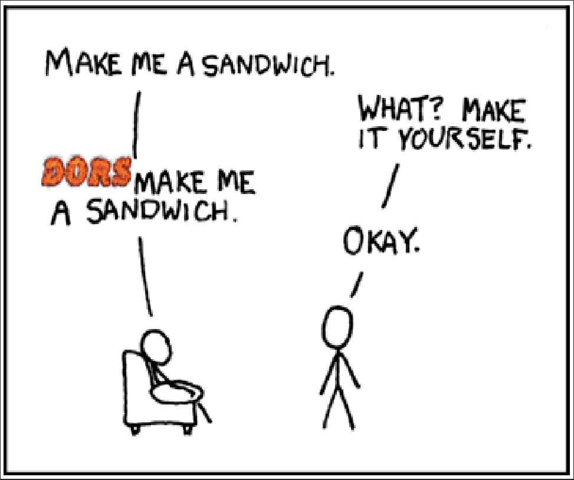

# OpenDors
A sudo/opendoas clone written in rust.



## Usage
```bash
usage: dors [-nus] [-C config] [-u user] [command]
    -C config -- The config file
    -n -- Non-interactive mode. Will fail if password required
    -u -- The user. Default is root
    -s -- Replace the command with $SHELL
```

User permissions are determined via the `/etc/dors.toml` file. Each entry should look something like this:

```toml
[username]
is_group = false
permitted_as = [ "*" ]
pass = true
log = false
persist = true
persist_len = 60 # persist for 60 seconds
keep_env = [
 "DISPLAY",
 "TERM"
]
custom_env = [
 { name = "EDITOR", value = "nvim" }
]
```

This will allow the user `username` to run as any user (indicated by `"*"`), given they enter their password. The session will persist for 60 seconds, meaning they can re-run `dors` without being prompted for a password. The `$DISPLAY` and `$TERM` variables are inherited from the shell that `dors` is executed from, and the `$EDITOR` is always set to `nvim`.

Setting `is_group = true` will give these permissions to all users of the group, assuming there isn't a more specific config entry (i.e. one that specifies the user directly).
